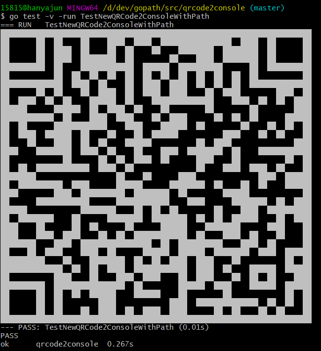
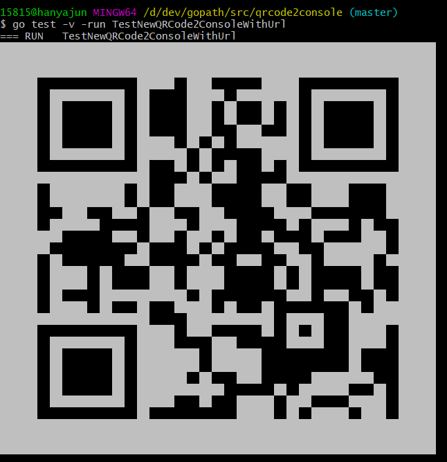

# QRCode2Console

一个将二维码输出到控制台的Go语言工具库。支持从URL生成二维码或从现有二维码图片读取，并在终端中显示。

## 功能特性

- ✅ 从URL生成二维码并输出到控制台
- ✅ 从图片文件读取二维码并输出到控制台
- ✅ 支持黑白和彩色输出
- ✅ 生成二维码图片文件（可选）
- ✅ 完善的错误处理
- ✅ 支持Go 1.24+ 最新特性
- ✅ 提供字符串输出接口

## 安装

```bash
go get github.com/Han-Ya-Jun/qrcode2console
```

## 快速开始

### 基本用法

```go
package main

import (
	"fmt"
	"github.com/Han-Ya-Jun/qrcode2console"
)

func main() {
	// 从URL生成二维码
	qr, err := qrcode2console.NewWithURL("https://hanyajun.com", false)
	if err != nil {
		fmt.Printf("创建二维码失败: %v\n", err)
		return
	}
	
	// 输出到控制台
	if err := qr.Output(); err != nil {
		fmt.Printf("输出二维码失败: %v\n", err)
	}
}
```

### 从图片文件读取

```go
func main() {
	// 从图片文件读取二维码
	qr, err := qrcode2console.NewWithPath("qrcode.png")
	if err != nil {
		fmt.Printf("读取二维码图片失败: %v\n", err)
		return
	}
	
	// 彩色输出
	if err := qr.OutputColored(); err != nil {
		fmt.Printf("输出二维码失败: %v\n", err)
	}
}
```

### 获取字符串格式

```go
func main() {
	qr, err := qrcode2console.NewWithURL("https://example.com", false)
	if err != nil {
		fmt.Printf("创建二维码失败: %v\n", err)
		return
	}
	
	// 获取字符串形式的二维码
	qrString, err := qr.ToString()
	if err != nil {
		fmt.Printf("转换二维码失败: %v\n", err)
		return
	}
	
	fmt.Println(qrString)
}
```

## API 文档

### 类型

#### `QRCode2Console`

二维码到控制台转换器的主要结构体。

### 构造函数

#### `NewWithURL(url string, genImg bool) (*QRCode2Console, error)`

从URL创建二维码转换器。

- `url`: 要生成二维码的URL
- `genImg`: 是否生成二维码图片文件
- 返回值: 二维码转换器实例和错误信息

#### `NewWithPath(path string) (*QRCode2Console, error)`

从图片路径创建二维码转换器。

- `path`: 二维码图片文件路径
- 返回值: 二维码转换器实例和错误信息

### 方法

#### `Output() error`

在控制台输出黑白二维码。

#### `OutputColored() error`

在控制台输出彩色二维码（使用ANSI颜色代码）。

#### `ToString() (string, error)`

将二维码转换为字符串格式。

#### `SetImage(img image.Image) error`

设置自定义图片作为二维码源。

## 示例

### 示例1：生成并保存二维码图片

```go
qr, err := qrcode2console.NewWithURL("https://github.com/Han-Ya-Jun", true)
if err != nil {
    log.Fatal(err)
}

qr.OutputColored()
// 同时会生成 qrcode.png 文件
```

### 示例2：批量处理

```go
urls := []string{
    "https://github.com/Han-Ya-Jun",
    "https://hanyajun.com",
    "https://example.com",
}

for _, url := range urls {
    fmt.Printf("二维码: %s\n", url)
    qr, err := qrcode2console.NewWithURL(url, false)
    if err != nil {
        fmt.Printf("错误: %v\n", err)
        continue
    }
    
    qr.Output()
    fmt.Println()
}
```

## 命令行工具

项目中包含一个简单的命令行工具示例：

```go
// cmd/qrcode2console/main.go
package main

import (
	"flag"
	"fmt"
	"os"
	"github.com/Han-Ya-Jun/qrcode2console"
)

func main() {
	url := flag.String("url", "", "要生成二维码的URL")
	path := flag.String("path", "", "二维码图片路径")
	colored := flag.Bool("color", false, "使用彩色输出")
	flag.Parse()
	
	var qr *qrcode2console.QRCode2Console
	var err error
	
	if *url != "" {
		qr, err = qrcode2console.NewWithURL(*url, false)
	} else if *path != "" {
		qr, err = qrcode2console.NewWithPath(*path)
	} else {
		fmt.Println("请提供 -url 或 -path 参数")
		os.Exit(1)
	}
	
	if err != nil {
		fmt.Printf("错误: %v\n", err)
		os.Exit(1)
	}
	
	if *colored {
		qr.OutputColored()
	} else {
		qr.Output()
	}
}
```

该命令行工具还支持 `-gen-img` 和 `-output` 参数，用于生成二维码图片文件和将二维码字符串写入文件。

## 测试

运行测试：

```bash
cd qrcode2console
go test -v
```

测试用例包括：
- 从URL生成二维码测试
- 从图片文件读取二维码测试
- 错误处理测试

## 依赖

- [github.com/skip2/go-qrcode](https://github.com/skip2/go-qrcode) - 二维码生成
- [github.com/disintegration/imaging](https://github.com/disintegration/imaging) - 图片处理

## 许可证

MIT License - 详见 LICENSE 文件

## 贡献

欢迎提交 Issue 和 Pull Request！

## 作者

Han-Ya-Jun

## 更新日志

### v1.0.0 (2026-02-01)
- 初始版本发布
- 支持URL和图片文件输入
- 黑白/彩色输出
- 字符串格式输出
- 完善的错误处理

## 效果展示

### 黑白输出


### 彩色输出  

